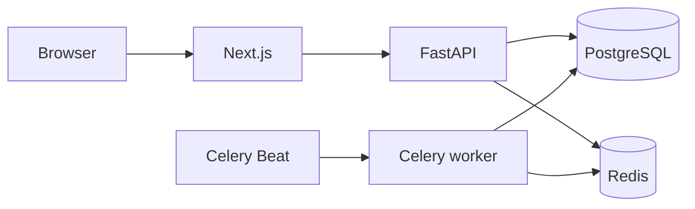

# BowlByte — Intelligent Canteen Automation, Smart Queue Management and Food Waste Reduction Platform

Project report source. The editable Word file is `BOWLBYTE_PROJECT_REPORT.docx`, built with python-docx from this Markdown. A report PDF was **NOT GENERATED**. Pandoc is not installed. This document does not follow a college template. No template was in the repository. Screenshots of the running site are in `screenshots/`. The pickup QR in those images was redeemed in the same run (`PICKED_UP`). Accounts are synthetic.

**College:** [Not recorded in the BowlByte repository. Do not assume a name.]

**Team, guide, roll numbers:** [Not recorded. Leave blank until the department list is supplied.]

**Status:** Local demonstration system. Not a public deployment. Forecast numbers are from a seeded series.

## 1. Introduction

College canteens queue students at a counter, guess how much food to cook, and collect cash by hand. BowlByte is a web application for ordering ahead, preparing food at named stations, collecting cash at the counter, and recording what was cooked and discarded. It does not take online payment.

## 2. Problem statement

Students wait without knowing whether the kitchen has started their order. Staff can oversell a dish if two people ask for the last portion. Cash corrections, when they exist, are often unlogged. Food waste is remembered rather than recorded. A forecast that is not tied to real orders can be mistaken for a measurement.

## 3. Objectives and scope

In scope: accounts and roles, menu and stock, kitchen tasks and estimates, cash receipts, one-time QR pickup, in-app notifications, an unclaimed-order hold, production and waste records, and a forecast that a manager must choose.

Out of scope: card or UPI payment, a public internet launch, a proven reduction in waste, and phone notification display. Those last two were not observed.

## 4. Existing systems and limitations

A paper token or a shared spreadsheet does not lock stock, does not keep an append-only receipt, and does not separate one student's order from another's. BowlByte keeps those rules in PostgreSQL and checks the role on the API.

## 5. Proposed solution

One Next.js site and one FastAPI service. The browser calls `/api/v1` on the same origin. PostgreSQL stores orders and money. Redis carries rate limits and live hints. Celery delivers notifications and trains models after the request has committed.

## 6. System requirements

A manager, kitchen staff, cashiers, and students. Docker Compose for the demo: PostgreSQL 16, Redis, the API, a worker, Beat, the web app, and Mailpit for local mail. The demo uses ports 3010, 8010, 5433, 6379, and 8025 because another project already uses the default application ports.

## 7. System architecture

WebSocket messages are hints. The page refetches the order. Staging, when used, puts Caddy in front of Next.js only. That staging project was configured and not started.

## 8. Technologies

Next.js 16.4, TypeScript, Tailwind CSS, FastAPI, SQLAlchemy, Alembic, PostgreSQL 16, Redis, Celery, and scikit-learn for one forecast candidate. Tests use pytest, Vitest, and Playwright.

## 9. Database design

Migrations `0001_baseline` through `0007_pickup_holds`. Orders move through checked statuses. Cash receipts, reversals, and pickup events are append-only. Menu images are bytes on the menu item row. Daily stock is separate from production batches. Demo demand is a separate table and is not an order.

## 10. Authentication and role security

Passwords use Argon2id. Sessions are server rows and HttpOnly cookies. Production requires `Secure` and the `__Host-` cookie names. CSRF is a header on mutating requests. Students, kitchen staff, cashiers, and managers are different roles. Staff act inside one canteen.

Institutional email proves the mailbox domain only. Roster mode binds a roll number to an enrollment code. No college roster was imported for this report.

## 11. Student ordering

The student places an order with an idempotency key. The payment method is cash and the payment status is pending. Stock is reserved in that transaction. Another student cannot open the order.

## 12. Kitchen queue and ETA

Accepting an order creates one task per portion on the item's station. Starting a task checks station capacity and ticket order. The estimate uses remaining durations and a packing buffer. A laptop run of 100 sequential place-and-accept operations took about 28 seconds before the estimate query was narrowed and about 27 seconds after. That is one process, not a canteen capacity figure.

## 13. Cash and QR pickup

The cashier confirms the amount received. A receipt row is inserted. A retry does not insert a second receipt. The student's QR is a one-time token with its own expiry, default 10 minutes. Pickup requires the order to be ready and paid. A manager reversal is a new row with a reason.

## 14. Notifications and PWA

The ready transition writes an in-app notification and an outbox row together. The worker delivers pushes later. The service worker caches the offline page and icon, not API responses or QR secrets. The manifest is `frontend/public/manifest.webmanifest`. No physical phone displayed a notification.

## 15. Production and waste

A batch records produced food. The equation is produced = served at the counter + remaining + discarded. Waste reasons are chosen by a manager. Approving a preparation plan does not create a batch.

## 16. Forecasting methodology

The target is demand quantity by item and day. The split is chronological. The holdout is not used to pick the model. On the seeded run recorded on 15 October 2026, 60 rows, one item, 50 open days:

| Model | Validation MAE | Holdout MAE |
| --- | --- | --- |
| Seasonal naive | 2.143 | 1.143 |
| HistGradientBoosting | 3.000 | 2.286 |

Seasonal naive remained selected. These figures are not real canteen accuracy. A later demonstration training on 16 October 2026, shown in `screenshots/forecast-1280.png`, again kept seasonal naive. That card reports holdout MAE 1.69 for seasonal naive and 2.15 for histogram gradient boosting, on a demo window of 55 points, and states that the validation error did not beat the baseline. It is not a measurement of a real canteen.

## 17. Preparation planning

The planner is a greedy quantity suggestion with stored weights. It explains a recommendation. The manager approves or ignores it. Approval does not change orders or stock.

## 18. Implementation notes

Kitchen code locks open orders before a capacity change. Pickup and cash lock the order, then the payment or credential. The unclaimed sweep locks ready orders whose hold time has passed. A concurrent pickup that already committed is left alone.

## 19. Testing

P008 re-ran the suites on 16 October 2026. Backend unit tests: 65 passed. PostgreSQL integration: 85 passed and 2 skipped. Vitest: 39 passed. Playwright: 33 passed, including a responsive capture at 390, 768, and 1280 pixels. Two integration tests stay skipped unless `P005_PERF=1`. They were not counted as passed.

## 20. Results and discussion

The demonstration path from menu to picked-up order is implemented and covered by Playwright. The forecast comparison shows why a small seasonal series kept the baseline. No before-and-after waste study was run, so the project does not report a reduction.

## 21. Security and reliability

See `docs/P008_SECURITY_AND_LIMITATIONS.md`. On 16 October 2026 a custom-format dump of the development database took 757 ms and a restore into `bowlbyte_restore` took 1728 ms. Both sides showed revision `0007_pickup_holds` and the same order count. The disposable database and the dump file were then removed. The development database was not reset.

## 22. Limitations

No public HTTPS site, no phone push observation, no official roster, no shift-close feature, shared local rate-limit label, and an open WebSocket that is not cut at the instant of logout.

## 23. Future scope

A college hostname, roster import, one observed phone notification, and a longer recorded demand history before revisiting the model choice.

## 24. Conclusion

BowlByte is a working local canteen system with explicit money and stock rules. It is suitable for a supervised demonstration. It is not a public production service, and its forecast scores are synthetic.

## 25. References

- PostgreSQL 16 documentation, constraint and dump/restore behavior: https://www.postgresql.org/docs/
- FastAPI documentation: https://fastapi.tiangolo.com/
- Celery documentation: https://docs.celeryq.dev/
- scikit-learn `HistGradientBoostingRegressor`: https://scikit-learn.org/stable/modules/generated/sklearn.ensemble.HistGradientBoostingRegressor.html
- NIST password guidance is the reason Argon2id is used; the implementation is the argon2-cffi library already in the backend lockfile.

No journal paper was written or accepted for this project. Do not add a fake citation.

## 26. Appendix — order states

`PLACED`, `ACCEPTED`, `QUEUED`, `PREPARING`, `READY`, `PICKED_UP`, `REJECTED`, `CANCELLED`, `UNCLAIMED`.

`UNCLAIMED` means the pickup hold elapsed. It is not a refund and not a waste record.
