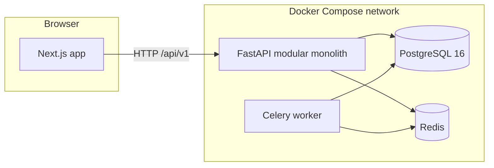

# Architecture

BowlByte is a modular monolith. One web application and one API process own the canteen workflow. PostgreSQL is the system of record. Redis carries background jobs and, later, short-lived coordination. Celery workers run those jobs. The browser talks to the API over HTTP. Live order updates will later use WebSockets, and Web Push will later use VAPID. Neither is implemented in P001.



PostgreSQL and Redis publish ports on `127.0.0.1` only. They are not bound to every network interface. The API and web app are also bound to loopback in this development compose file.

## Repository

| Path | Responsibility |
| --- | --- |
| `frontend/` | Next.js App Router, role shells, design system |
| `backend/` | FastAPI application, persistence, migrations, worker process |
| `ml/` | Reserved for a later forecasting phase. No model is trained in P001 |
| `docs/` | Product and technical contract |
| `scripts/` | Local startup helpers |
| `.github/workflows/` | Lint and test CI |
| `docker-compose.yml` | Pilot runtime: web, API, worker, PostgreSQL, Redis |

## Backend modules

The API is one deployable service with internal module boundaries.

| Module | P001 contents | Later contents |
| --- | --- | --- |
| `app/api` | Versioned routers. Only operations routes exist | Orders, menus, payments, identity |
| `app/core` | Settings, JSON logs, error envelope | Shared security helpers |
| `app/db` | Engine, session dependency, declarative base | Transaction helpers used by order and payment services |
| `app/models` | Empty package | Tables documented in `DATABASE_DESIGN.md` |
| `app/schemas` | Health and readiness models | Request and response models |
| `app/services` | PostgreSQL and Redis probes | Order, payment, queue, and notification services |
| `app/worker.py` | Celery application and `bowlbyte.worker_ping` | Preparation timing, notification delivery, cleanup |

`bowlbyte.worker_ping` returns `ok` when a worker executes it. It does not send a notification or change an order.

Route handlers stay thin. When orders exist, a handler will authenticate the caller, call one service function, and return a schema. The service function will own the transaction. Handlers will not commit partial order and payment writes.

## Frontend modules

| Area | Route | Access in P001 |
| --- | --- | --- |
| Public marketing and rules | `/` | Public |
| Live process status | `/status` | Public. Calls the real health and readiness endpoints |
| Student | `/student`, `/student/menu`, `/student/orders` | Scaffold. No session check exists yet |
| Kitchen staff | `/staff`, `/staff/queue` | Scaffold |
| Cashier | `/cashier` | Scaffold |
| Canteen manager | `/admin`, `/admin/menu` | Scaffold |

Public pages and future protected pages use different layouts. The operations layout states that no session is checked. There is no pretend login and no sample operational data.

The browser calls `NEXT_PUBLIC_API_URL`. Inside Docker Compose that value is `http://localhost:8000` because the browser runs on the host, not inside the frontend container.

## Request and error path

1. Uvicorn receives the request.
2. CORS allows the configured web origins.
3. A versioned router handles `/api/v1/...`.
4. Expected failures raise `ApiError` or `HTTPException` and return one envelope:

```json
{
  "error": {
    "code": "HTTP_ERROR",
    "message": "Not Found",
    "details": {}
  }
}
```

5. Unexpected exceptions are logged with a traceback and returned as `INTERNAL_ERROR` without the traceback or a connection string.

Logs are single-line JSON on stdout. Readiness failures log the exception class name, not the exception text, so a database URL cannot leak into the log message.

## Readiness versus liveness

`GET /api/v1/health` only proves the process can answer. It does not touch PostgreSQL or Redis.

`GET /api/v1/ready` runs `SELECT 1` and `PING`. Both must succeed. A failure returns HTTP 503 and `"status": "not_ready"` with `up` or `down` for each check. The body does not include the database password or the raw driver error text.

The API process can start when a dependency is down, so a liveness probe is not tied to the database. The compose health check for the API uses `/api/v1/health`. The backend command applies Alembic migrations before it starts Uvicorn. The worker does not run migrations.

## Configuration

`app/core/config.py` loads typed settings from the environment. Defaults match `.env.example` and are development placeholders. Production must replace `DATABASE_URL`, `REDIS_URL`, and any future signing keys. No production secret is stored in the repository.

OpenAPI is served at `/docs` outside production and disabled when `ENVIRONMENT=production`.

## Persistence boundary

PostgreSQL stores durable canteen state. Redis does not. A future WebSocket fan-out or cache may use Redis, and losing Redis may delay a job, but it must not be the only copy of an order or a payment.

Alembic revision `0001_baseline` creates no domain tables. The target schema in `DATABASE_DESIGN.md` is the design, not a migrated database.

## Multi-canteen boundary

Every operational table in the target schema includes `canteen_id`. Staff authorization checks that identifier. P001 runs one database and one compose stack, which is the pilot deployment shape. A second canteen should be another row, not another service, until a measured operational need says otherwise.

## Explicit non-goals for the runtime

- No payment provider container or SDK
- No message that a push notification was delivered
- No forecast value
- No QR token issuer
