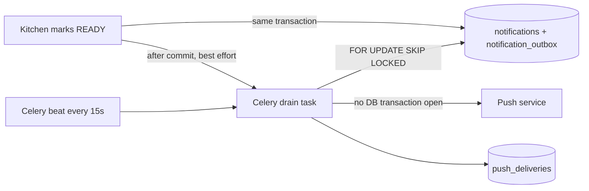

# P005 Web Push architecture

Push is a reminder channel. The order page and the in-app notification list are the source of truth. "Accepted by the push service" is the strongest thing BowlByte can claim. It never says a notification was displayed.

## Transactional outbox

`mark_ready` inserts the in-app notification and one outbox row in the same transaction as the `READY` change. The event key is `ORDER_READY:{order_id}:{version}` with `ON CONFLICT DO NOTHING`, so a retried request cannot create a second one. If the transaction rolls back, neither row exists. Measured cost of the insert is about 7 ms (see `P005_TEST_RESULTS.md`).

After commit, `kick_worker` sends a Celery task from a short daemon thread so the kitchen request never waits. If Redis is down, nothing breaks. The beat schedule (`NOTIFICATION_BEAT_SECONDS`, 15) picks the event up.

## Draining

`drain_outbox` claims due events with `FOR UPDATE SKIP LOCKED` and a `locked_until` lease, so several workers can run at once. It commits claims before network I/O and holds no transaction while talking to a push service.

For each event it:

1. Expires it if older than 1800 seconds.
2. Marks it `STALE` if the order is no longer `READY` (nobody is told "ready" for a collected order).
3. Marks it `NO_SUBSCRIPTION` if the student has no enabled device. The in-app record still exists.
4. Creates one `push_deliveries` row per enabled device (unique per event and device).
5. Skips a device whose owner changed (`recipient_changed`) or whose subscription expired.
6. Sends, then records the result.

## Delivery states

| State | Meaning |
| --- | --- |
| `PENDING` | Will be tried again at `next_attempt_at` |
| `ACCEPTED` | The push service returned 200, 201 or 202. Not proof of display |
| `REJECTED` | Permanent client error (400, 401, 403, 413, or another unlisted 4xx). Not retried |
| `GONE` | 404 or 410. The subscription is disabled |
| `FAILED` | Retries exhausted (5 attempts) |
| `SKIPPED` | Not sent (disabled device, changed owner, expired subscription) |

Retryable: network errors, timeouts, `429` (honours `Retry-After`) and `5xx`. Backoff is `30 * 2^(n-1)` seconds, capped at 3600. The outbox event becomes `DONE` with result `ACCEPTED`, `PARTIAL`, `FAILED`, `STALE`, `EXPIRED` or `NO_SUBSCRIPTION`.

## Subscriptions

- Registered by the student from the profile page after a click. The browser asks for permission only then.
- One row per endpoint hash. Registering the same endpoint on another account moves it to the current user. Logout unsubscribes the device locally and asks the server to delete it, so a shared phone does not keep receiving the previous student's messages.
- Endpoint and keys are encrypted at rest with Fernet (key derived from `PUSH_ENCRYPTION_KEY`).
- A user can hold at most 10 devices.

## SSRF controls

Endpoints are accepted only if they are `https`, port 443, with no user info and no IP literal, and the host matches the allowlist: `fcm.googleapis.com`, `updates.push.services.mozilla.com`, `*.push.services.mozilla.com`, `*.notify.windows.com`, `web.push.apple.com`, `*.push.apple.com` (`PUSH_ALLOWED_HOSTS`). The sender resolves the host and refuses private addresses, does not follow redirects and ignores proxy environment variables.

Residual risk: DNS can change between the check and the connection (rebinding). The allowlist of public push hosts and the redirect ban reduce it. They do not remove it.

## Keys

Generate with `python -m app.cli.generate_vapid`. It prints the VAPID public and private keys, `PICKUP_HASH_KEY` and `PUSH_ENCRYPTION_KEY` to the terminal only. Put them in `.env` (git-ignored) or a secret store. The private key reaches only the worker container (checked in the running stack: the backend, beat and frontend containers have it empty). The API and beat containers get the public key. Production refuses to start with `dev-only` secrets or with test endpoints enabled.

## Test simulator

`PUSH_ALLOW_TEST_ENDPOINTS=true` lets the reserved host `push-test.bowlbyte.invalid` be routed to a built-in simulator. The path chooses the outcome (`accept`, `gone`, `throttle`, `fail`, `reject`, `timeout`, `flaky`). It exists so tests can prove BowlByte's own behaviour. It is off by default and rejected in production. It proves nothing about a phone.

## Endpoints

`GET /push/public-key`, `GET/POST/DELETE /push/subscriptions`, `POST /push/test` (3 per 10 minutes), `GET /notifications`, `GET /notifications/unread-count`, `POST /notifications/read-all`, `POST /notifications/{id}/read`, `GET /admin/push/metrics`, and WebSockets `/ws/cashier` and `/ws/notifications`.
